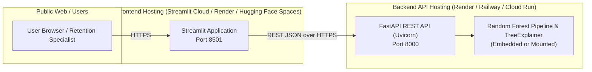

# Production Deployment Guide: Telco Customer Churn Intelligence & Explainable AI Platform

This guide outlines practical, production-ready deployment strategies for the decoupled **FastAPI REST Backend** and **Streamlit Intelligence Dashboard**.

---

## 1. Deployment Architecture

The application is architected as two decoupled microservices:



### Architectural Key Points:
- **Decoupled Communication:** The Streamlit dashboard communicates with FastAPI strictly via standard HTTP REST (`/predict`, `/explain`, `/health`, `/benchmark`).
- **Stateless Inference:** The FastAPI backend does not maintain session state; each prediction request is independently validated and scored.
- **Resource Footprint:** 
  - Backend: ~500 MB RAM (Scikit-Learn model pipeline ~8.2 MB + TreeExplainer graph in memory).
  - Frontend: ~250 MB RAM (Streamlit runtime + UI components).
  - Can comfortably run on free or low-cost tiers (512 MB – 1 GB RAM).

---

## 2. Recommended Hosting Providers (Free & Low-Cost)

| Platform | Best For | Recommended Service | Free Tier / Cost | Notes |
| :--- | :--- | :--- | :--- | :--- |
| **Render** | Backend + Frontend | Web Services (Docker or Native Python) | Free (spins down on inactivity) / $7/mo | Native Docker support with zero configuration. |
| **Railway** | Full-Stack Containers | Multi-service project via `docker-compose.yml` | Free trial / ~$5/mo usage | Automatically detects Dockerfile targets. |
| **Streamlit Community Cloud** | Frontend Dashboard | Streamlit App connected to GitHub | 100% Free | Connects to deployed FastAPI backend URL via `API_URL` secret. |
| **Hugging Face Spaces** | Frontend or Unified | Docker Space or Streamlit Space | 100% Free (2 vCPU, 16 GB RAM) | Excellent community visibility for portfolio projects. |
| **Google Cloud Run** | Production API | Fully managed serverless container | Free tier (2M requests/month) | Scales to zero when idle; enterprise reliability. |

---

## 3. Recommended Multi-Service Deployment Strategy

### Strategy A: Streamlit Community Cloud (Frontend) + Render / Railway (Backend)
This is the recommended free deployment architecture:

1. **Deploy Backend to Render:**
   - Sign up at [render.com](https://render.com).
   - Create a **New Web Service** pointing to your repository `https://github.com/Kanishk199/customer-churn-prediction`.
   - Environment: **Docker**.
   - Docker Command / Target: `backend` (or build using `Dockerfile` target `backend`).
   - Port: `8000`.
   - Environment Variables:
     ```bash
     API_HOST=0.0.0.0
     API_PORT=8000
     MODEL_PATH=models/best_churn_model.joblib
     AUDIT_REPORT_PATH=models/model_comparison_report.json
     ```
   - Once deployed, your backend URL will be: `https://your-backend-app.onrender.com`.
   - Verify health: `https://your-backend-app.onrender.com/health` returns `{"status": "healthy"}`.

2. **Deploy Frontend to Streamlit Community Cloud:**
   - Sign in to [share.streamlit.io](https://share.streamlit.io) with GitHub.
   - Click **New app** and select:
     - Repository: `Kanishk199/customer-churn-prediction`
     - Branch: `main`
     - Main file path: `app/streamlit_app.py`
   - In **Advanced settings**, set Environment Variables / Secrets:
     ```toml
     API_URL = "https://your-backend-app.onrender.com"
     ```
   - Deploy. Streamlit will now communicate directly with your live FastAPI backend.

---

### Strategy B: Full-Stack Container Deployment via Docker Compose

On any Linux VPS, AWS EC2, DigitalOcean Droplet, or Railway:

```bash
# 1. Clone repository
git clone https://github.com/Kanishk199/customer-churn-prediction.git
cd customer-churn-prediction

# 2. Configure environment (optional custom port overrides)
cp .env.example .env

# 3. Build and launch containers
docker compose build
docker compose up -d

# 4. Confirm container health
docker compose ps

# Expected output:
# NAME                         IMAGE                              STATUS                    PORTS
# churn-prediction-api         churn-prediction-backend:latest    Up (healthy)              0.0.0.0:8000->8000/tcp
# churn-prediction-dashboard   churn-prediction-frontend:latest   Up (healthy)              0.0.0.0:8501->8501/tcp
```

---

## 4. Environment Variables Reference

| Variable Name | Default Value | Description | Used By |
| :--- | :--- | :--- | :--- |
| `API_HOST` | `0.0.0.0` | IP interface binding for FastAPI | Backend |
| `API_PORT` | `8000` | HTTP port for FastAPI REST API | Backend |
| `MODEL_PATH` | `models/best_churn_model.joblib` | Path to the trained Scikit-Learn pipeline | Backend |
| `AUDIT_REPORT_PATH` | `models/model_comparison_report.json` | Path to the model comparison benchmark report | Backend |
| `API_URL` | `http://127.0.0.1:8000` | Target URL used by Streamlit to reach FastAPI | Frontend |
| `STREAMLIT_SERVER_PORT` | `8501` | HTTP port for Streamlit UI | Frontend |
| `STREAMLIT_SERVER_ADDRESS` | `0.0.0.0` | Network address binding for Streamlit | Frontend |
| `STREAMLIT_SERVER_HEADLESS` | `true` | Runs Streamlit in headless server mode | Frontend |

---

## 5. Deployment Health Verification

After deploying your services, execute this diagnostic sequence:

### 1. Test Backend Health Probe
```bash
curl -f https://<your-backend-domain>/health
```
**Expected Response:**
```json
{
  "status": "healthy",
  "model_loaded": true,
  "model_type": "Random Forest Classifier",
  "version": "1.0.0",
  "classification_threshold": 0.5,
  "low_risk_upper_bound": 0.3,
  "medium_risk_upper_bound": 0.6,
  "features_expected": 19
}
```

### 2. Test Real-Time Inference & SHAP Calculation
```bash
curl -X POST "https://<your-backend-domain>/predict" \
     -H "Content-Type: application/json" \
     -d '{
       "gender": "Female",
       "SeniorCitizen": 0,
       "Partner": "No",
       "Dependents": "No",
       "tenure": 2,
       "PhoneService": "Yes",
       "MultipleLines": "No",
       "InternetService": "Fiber optic",
       "OnlineSecurity": "No",
       "OnlineBackup": "No",
       "DeviceProtection": "No",
       "TechSupport": "No",
       "StreamingTV": "Yes",
       "StreamingMovies": "Yes",
       "Contract": "Month-to-month",
       "PaperlessBilling": "Yes",
       "PaymentMethod": "Electronic check",
       "MonthlyCharges": 92.50,
       "TotalCharges": 185.00
     }'
```

### 3. Verify Response Headers
Confirm that `X-Process-Time` is present in the response headers to verify the latency middleware:
```bash
curl -I https://<your-backend-domain>/health
# Look for: X-Process-Time: 0.0012s
```

---

## 6. Common Troubleshooting Scenarios

### Error: "Cannot communicate with FastAPI backend" in Streamlit
- **Cause:** `API_URL` environment variable is either unset or pointing to `localhost` inside a container.
- **Fix:** Inside Docker Compose, set `API_URL=http://backend:8000`. On cloud deployments, set `API_URL` to the public HTTPS URL of your deployed FastAPI service.

### Error: Free Tier Backend "Cold Starts" (50–60 second latency)
- **Cause:** Free-tier providers like Render spin down inactive containers after 15 minutes of zero traffic.
- **Fix:** Keep a simple cron/health ping (e.g., using [cron-job.org](https://cron-job.org) or UptimeRobot) pinging `GET /health` every 10 minutes to maintain an active container.

### Error: Out-of-Memory (OOM) Killed during Docker Build
- **Cause:** Machine has less than 2 GB RAM when compiling dependencies.
- **Fix:** Use pre-compiled wheels: `pip install --no-cache-dir -r requirements.txt` (already configured in Dockerfile).

### Error: Cross-Origin Resource Sharing (CORS) Block
- **Cause:** Browser blocks cross-origin requests between different domains.
- **Fix:** FastAPI is already pre-configured with `CORSMiddleware(allow_origins=["*"])` in `api/main.py`.
