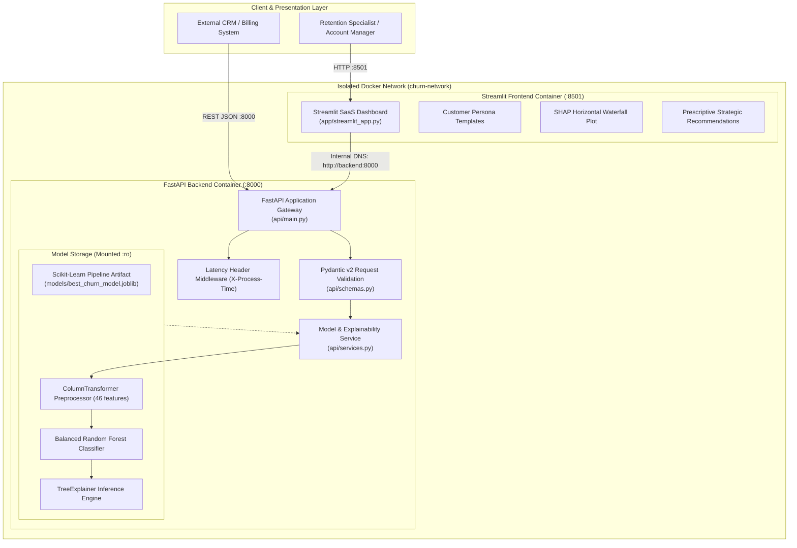
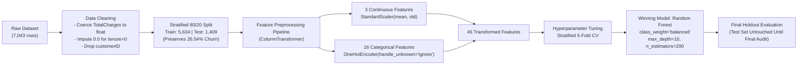
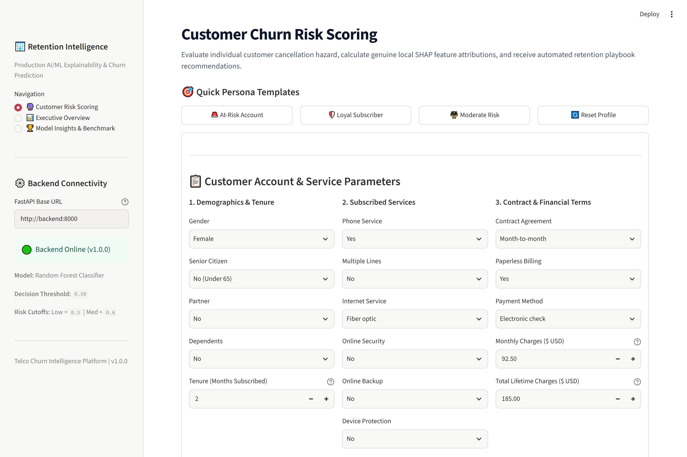
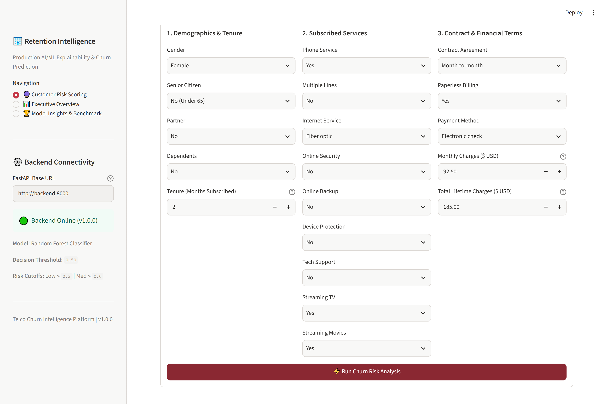
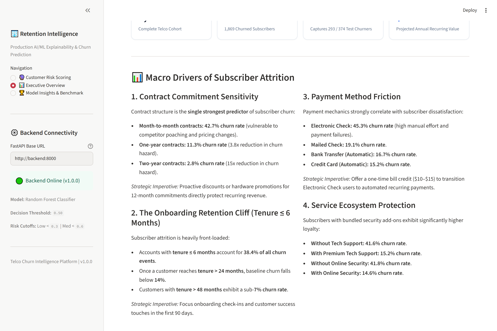
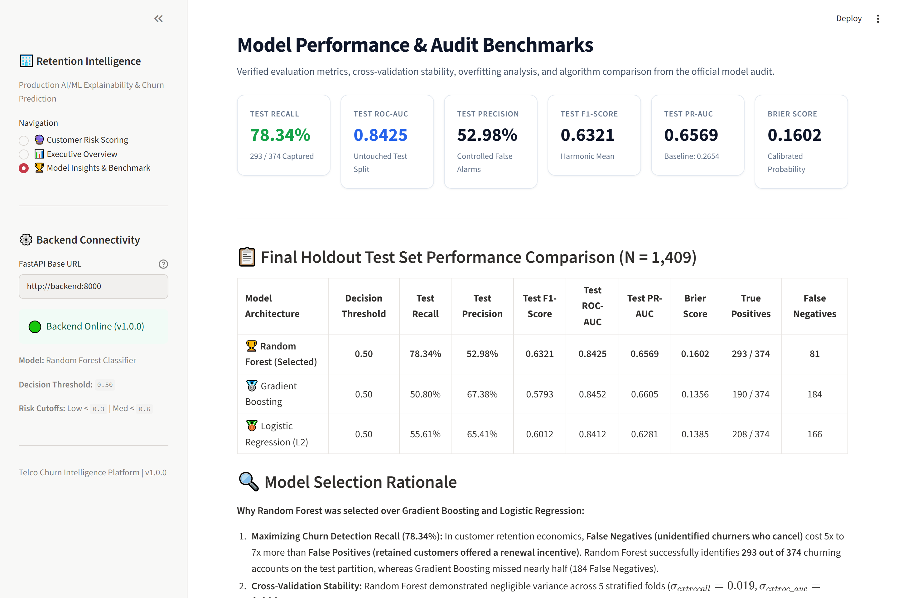

# Telco Customer Churn Intelligence & Explainable AI Platform

[](https://www.python.org/)
[](https://fastapi.tiangolo.com/)
[](https://streamlit.io/)
[](https://scikit-learn.org/)
[](https://github.com/shap/shap)
[](https://www.docker.com/)
[](https://docs.pytest.org/)
[](LICENSE)

An end-to-end Machine Learning and Explainable AI (XAI) platform for subscription customer retention. The platform combines a calibrated Scikit-Learn **Random Forest** ensemble with **Tree SHAP** local attributions, served via an asynchronous **FastAPI** microservice and an interactive **Streamlit** analytics dashboard.

---

## Table of Contents

- [1. Project Overview](#1-project-overview)
- [2. Business Problem & Real-World Use Case](#2-business-problem--real-world-use-case)
- [3. Key Features](#3-key-features)
- [4. System Architecture](#4-system-architecture)
- [5. Complete Machine Learning Pipeline](#5-complete-machine-learning-pipeline)
- [6. Dataset Description](#6-dataset-description)
- [7. Model Comparison & Evaluation](#7-model-comparison--evaluation)
- [8. Explainable AI Implementation Using SHAP](#8-explainable-ai-implementation-using-shap)
- [9. Backend REST API Documentation](#9-backend-rest-api-documentation)
- [10. Frontend Dashboard Overview](#10-frontend-dashboard-overview)
- [11. Docker Architecture & Containerization](#11-docker-architecture--containerization)
- [12. Installation Instructions](#12-installation-instructions)
- [13. Local Execution Instructions](#13-local-execution-instructions)
- [14. API Usage Examples](#14-api-usage-examples)
- [15. Automated Testing Suite (59 Tests)](#15-automated-testing-suite-59-tests)
- [16. Model Limitations & Responsible AI](#16-model-limitations--responsible-ai)
- [17. Production Deployment Guide](#17-production-deployment-guide)
- [18. Future Improvements](#18-future-improvements)
- [19. Repository Structure](#19-repository-structure)
- [20. License & Acknowledgements](#20-license--acknowledgements)

---

## 1. Project Overview

Customer churn poses a major operational and economic threat to subscription businesses. Traditional churn prediction systems suffer from two core limitations:
1. **The Black-Box Dilemma:** They provide opaque scores without explaining the specific causal factors driving a customer's attrition risk.
2. **False Negative Imbalance:** They optimize for generic accuracy, missing high-risk customers who cancel unexpectedly.

This platform bridges the gap between predictive modeling and commercial decision-making by coupling high-recall predictive scoring (**78.34% test recall**) with genuine local SHAP feature attributions and automated retention action playbooks.

---

## 2. Business Problem & Real-World Use Case

In the telecommunications industry, acquiring a new customer costs **5 to 7 times more** than retaining an existing subscriber. When an account cancels:
- The provider loses cumulative Monthly Recurring Revenue (MRR).
- The payback period on customer acquisition cost (CAC) is truncated.
- Customer lifetime value (LTV) drops precipitously.

```text
Asymmetric Retention Economics:
Cost of False Negative (Customer cancels unassisted)  >>  Cost of False Positive (Unnecessary discount offered)
                   ~$600 - $1,200 LTV Loss                              ~$15 - $30 Incentive Cost
```

Because lost subscribers are vastly more expensive than unnecessary retention incentives, the machine learning objective prioritizes **Recall** while maintaining strong precision and probability calibration.

---

## 3. Key Features

- **High-Recall Churn Classifier:** Captures **293 out of 374 churning accounts** on the holdout test set (78.34% recall, 0.8425 ROC-AUC).
- **Exact Local SHAP Explainability:** Uses `shap.TreeExplainer` operating directly in probability space to decompose each customer prediction down to machine precision.
- **Automated Risk Stratification:** Automatically triages subscribers into **Low Risk** ($P < 0.30$), **Medium Risk** ($0.30 \le P < 0.60$), and **High Risk** ($P \ge 0.60$) tiers.
- **Contextual Retention Playbooks:** Suggests specific commercial interventions (e.g., term contract migrations, billing automation discounts, tech support bundles) tailored to observed risk drivers.
- **Decoupled Architecture:** Strict separation of concerns where Streamlit communicates with FastAPI solely over HTTP REST; zero ML dependencies are imported into the UI layer.
- **Production Containerization:** Hardened multi-stage Docker build running under a non-root system user (`appuser:10001`) with healthchecks and isolated networking.

---

## 4. System Architecture



---

## 5. Complete Machine Learning Pipeline



### Pipeline Integrity Safeguards:
1. **Zero Data Leakage:** The preprocessing pipeline is fitted strictly on `X_train`. Imputer statistics and scaler means/variances are never computed over test data.
2. **Unseen Category Resilience:** `OneHotEncoder(handle_unknown='ignore')` safely zeroes out newly encountered category levels during inference without raising exceptions.
3. **Reproducibility Seed:** A fixed seed (`RANDOM_STATE = 42`) is propagated across all random splits, cross-validation folds, and tree ensemble initializations.

---

## 6. Dataset Description

The pipeline utilizes the **IBM Telco Customer Churn** dataset:
- **Total Records:** 7,043 customer accounts.
- **Target Variable:** `Churn` (`Yes` = 1, `No` = 0).
- **Class Balance:** 5,174 retained accounts (73.46%), 1,869 churned accounts (26.54%).
- **Features (19 predictive inputs):**
  - **Demographics:** `gender`, `SeniorCitizen`, `Partner`, `Dependents`.
  - **Account Tenure:** `tenure` (months subscribed, 0–72).
  - **Services Enrolled:** `PhoneService`, `MultipleLines`, `InternetService`, `OnlineSecurity`, `OnlineBackup`, `DeviceProtection`, `TechSupport`, `StreamingTV`, `StreamingMovies`.
  - **Contract & Financials:** `Contract`, `PaperlessBilling`, `PaymentMethod`, `MonthlyCharges`, `TotalCharges`.

---

## 7. Model Comparison & Evaluation

Three candidate architectures were tuned using Stratified 5-Fold Cross-Validation on the training partition ($N=5,634$). Final evaluation was conducted once on the untouched holdout test partition ($N=1,409$):

| Model Architecture | Decision Threshold ($\tau$) | Test Recall | Test Precision | Test F1-Score | Test ROC-AUC | Test PR-AUC | Brier Calibration | True Positives | False Negatives |
| :--- | :---: | :---: | :---: | :---: | :---: | :---: | :---: | :---: | :---: |
| 🏆 **Random Forest (Selected)** | **0.50** | **78.34%** | **52.98%** | **0.6321** | **0.8425** | **0.6569** | **0.1602** | **293 / 374** | **81** |
| 🥈 Gradient Boosting | 0.50 | 50.80% | 67.38% | 0.5793 | 0.8452 | 0.6605 | 0.1356 | 190 / 374 | 184 |
| 🥉 Logistic Regression (L2) | 0.50 | 55.61% | 65.41% | 0.6012 | 0.8412 | 0.6281 | 0.1385 | 208 / 374 | 166 |

### Evaluation Visualizations:

#### 1. Confusion Matrices Across Candidate Models


#### 2. ROC and Precision-Recall Curves


#### 3. Probability Calibration Reliability Diagram


#### 4. Global Feature Importance (SHAP Summary)


### Why Random Forest Was Selected:
1. **Superior Churn Detection (Recall = 78.34%):** Captures **293 out of 374** churning accounts. Gradient Boosting missed 184 churning customers.
2. **Minimal Overfitting Gap:** Training ROC-AUC (0.9265) vs. CV ROC-AUC (0.8464) demonstrates balanced generalization without extreme memorization.
3. **Cross-Validation Stability:** Fold-by-fold standard deviation was exceptionally low ($\sigma_{\text{recall}} = 0.019$, $\sigma_{\text{roc\_auc}} = 0.008$).

---

## 8. Explainable AI Implementation Using SHAP

Rather than relying purely on global feature importance, this platform calculates **local SHAP feature attributions** for each individual customer scoring request using `shap.TreeExplainer`.

### Mathematical Foundations:

1. **Probability Space Efficiency:**
   In Scikit-Learn's `RandomForestClassifier`, leaf values represent posterior class distributions. TreeExplainer computes attributions directly in probability space:
   $$\hat{P}(\text{Churn} = 1 \mid x) = E[f(X)] + \sum_{i=1}^{46} \phi_i(x)$$
   where $E[f(X)] \approx 0.5003$ is the baseline prior probability and $\phi_i(x) \in [-1, 1]$ is the contribution of transformed feature $i$.

2. **Machine Precision Verification:**
   The automated test suite verifies that the sum of the base value and all 46 feature contributions reconstructs the model prediction with machine residual $< 10^{-12}$:
   $$\left| \left( E[f(X)] + \sum_{i=1}^{46} \phi_i(x) \right) - \hat{P} \right| < 10^{-12}$$

3. **Directional Attribution:**
   - **Positive Contributions ($\phi_i > 0$):** Features accelerating churn hazard (e.g., month-to-month contract, low tenure, fiber optic with high bills). Displayed in **Red** with `+` percentage notation.
   - **Negative Contributions ($\phi_i < 0$):** Protective features anchoring retention (e.g., two-year contract commitment, automatic credit card billing, tech support add-on). Displayed in **Green** with `-` percentage notation.

---

## 9. Backend REST API Documentation

The backend service is built on FastAPI and Uvicorn. Interactive documentation is available at `/docs` (Swagger UI) and `/redoc` (ReDoc).

### REST Endpoints Directory:

| Method | Endpoint | Description | Response Schema |
| :--- | :--- | :--- | :--- |
| `GET` | `/` | Root directory and navigation metadata | `RootResponse` |
| `GET` | `/health` | Diagnostic probe for model status and thresholds | `HealthResponse` |
| `GET` | `/benchmark` | Verified evaluation metrics and audit report | `Dict[str, Any]` |
| `POST` | `/predict` | Real-time churn prediction, risk tier, and local SHAP | `PredictionResponse` |
| `POST` | `/explain` | Dedicated local SHAP feature breakdown | `ExplanationResponse` |

### Latency Telemetry:
Every request returns an `X-Process-Time` HTTP response header reporting end-to-end server execution time (typically `0.0010s` to `0.0080s`).

---

## 10. Frontend Dashboard Overview

The Streamlit dashboard is structured into three dedicated analytics portals:

### 1. Customer Churn Risk Scoring
Interactive customer profile input form with presets, visual risk gauge, prescriptive retention playbooks, and horizontal SHAP waterfall attribution chart:




### 2. Executive Overview & Portfolio KPIs
High-level overview of portfolio health, retention economics (\$2.42M projected protected ARR), and macro churn drivers:



### 3. Model Insights & Benchmark Evaluation
Verified holdout test set performance, hyperparameter specifications, confusion matrices, and ROC/PR evaluation curves:



---

## 11. Docker Architecture & Containerization

The system is orchestrated using Docker Compose across two isolated services communicating over a private bridge network (`churn-network`):

```yaml
# docker-compose.yml summary:
services:
  backend:
    build: { context: ., target: backend }
    ports: ["8000:8000"]
    volumes: ["./models:/app/models:ro"]
    healthcheck: { test: ["CMD-SHELL", "curl -f http://localhost:8000/health || exit 1"] }

  frontend:
    build: { context: ., target: frontend }
    ports: ["8501:8501"]
    environment: ["API_URL=http://backend:8000"]
    depends_on: { backend: { condition: service_healthy } }
```

### Security Hardening:
- **Non-Root Execution:** Containers run as `appuser` (UID `10001`).
- **Read-Only Model Volume:** Model artifacts are mounted with `:ro` to prevent runtime tampering.
- **Inter-Container DNS:** Frontend accesses backend via Docker service name `http://backend:8000`.

---

## 12. Installation Instructions

### Prerequisites
- Python 3.11 or 3.12
- Git
- Docker and Docker Compose (optional for containerized execution)

### 1. Clone Repository
```powershell
# Windows PowerShell:
git clone https://github.com/Kanishk199/customer-churn-prediction.git
cd customer-churn-prediction
```

```bash
# Linux / macOS:
git clone https://github.com/Kanishk199/customer-churn-prediction.git
cd customer-churn-prediction
```

### 2. Set Up Virtual Environment
```powershell
# Windows PowerShell:
python -m venv .venv
.\.venv\Scripts\Activate.ps1
python -m pip install --upgrade pip
pip install -r requirements.txt
```

```bash
# Linux / macOS:
python3 -m venv .venv
source .venv/bin/activate
python -m pip install --upgrade pip
pip install -r requirements.txt
```

---

## 13. Local Execution Instructions

### Option A: Running via Docker Compose (Recommended)
```bash
# 1. Build and launch both services
docker compose build
docker compose up -d

# 2. Verify container status
docker compose ps

# 3. View live logs
docker compose logs -f

# 4. Stop containers
docker compose down
```
- Dashboard: [http://localhost:8501](http://localhost:8501)
- Backend Docs: [http://localhost:8000/docs](http://localhost:8000/docs)

### Option B: Running Natively in Virtual Environment
Open two terminal windows:

- **Terminal 1 (Backend API):**
  ```powershell
  # Windows PowerShell:
  .\.venv\Scripts\Activate.ps1
  uvicorn api.main:app --host 127.0.0.1 --port 8000 --reload
  ```
  ```bash
  # Linux / macOS:
  source .venv/bin/activate
  uvicorn api.main:app --host 127.0.0.1 --port 8000 --reload
  ```

- **Terminal 2 (Frontend Dashboard):**
  ```powershell
  # Windows PowerShell:
  .\.venv\Scripts\Activate.ps1
  streamlit run app/streamlit_app.py --server.port 8501
  ```
  ```bash
  # Linux / macOS:
  source .venv/bin/activate
  streamlit run app/streamlit_app.py --server.port 8501
  ```

---

## 14. API Usage Examples

### 1. Diagnostic Health Check
```powershell
# Windows PowerShell:
curl.exe -s http://127.0.0.1:8000/health
```
```bash
# Linux / macOS:
curl -s http://127.0.0.1:8000/health
```
**Response:**
```json
{
  "status": "healthy",
  "model_loaded": true,
  "model_type": "Random Forest Classifier",
  "version": "1.0.0",
  "classification_threshold": 0.5,
  "low_risk_upper_bound": 0.3,
  "medium_risk_upper_bound": 0.6,
  "features_expected": 19
}
```

### 2. Predict Customer Churn Risk & Generate Local SHAP
```powershell
# Windows PowerShell:
curl.exe -X POST "http://127.0.0.1:8000/predict" `
  -H "Content-Type: application/json" `
  -d '{
    "gender": "Female",
    "SeniorCitizen": 0,
    "Partner": "No",
    "Dependents": "No",
    "tenure": 2,
    "PhoneService": "Yes",
    "MultipleLines": "No",
    "InternetService": "Fiber optic",
    "OnlineSecurity": "No",
    "OnlineBackup": "No",
    "DeviceProtection": "No",
    "TechSupport": "No",
    "StreamingTV": "Yes",
    "StreamingMovies": "Yes",
    "Contract": "Month-to-month",
    "PaperlessBilling": "Yes",
    "PaymentMethod": "Electronic check",
    "MonthlyCharges": 92.50,
    "TotalCharges": 185.00
  }'
```

**Response:**
```json
{
  "churn_prediction": 1,
  "churn_label": "Churn",
  "churn_probability": 0.913,
  "risk_tier": "High Risk",
  "classification_threshold": 0.5,
  "retention_recommendation": "Urgent retention intervention required. Incentivize migration to a 1-year or 2-year contract with a discounted renewal rate. Encourage automated payment setup (credit card or bank transfer) with a one-time bill credit. Offer complimentary 3-month trial of TechSupport and OnlineSecurity to reduce attrition friction.",
  "explanation": {
    "base_value": 0.5003,
    "predicted_probability": 0.913,
    "top_churn_drivers": [
      {
        "feature": "tenure",
        "feature_value": 2.0,
        "shap_value": 0.0703,
        "impact": "increases_churn",
        "description": "Customer is in the vulnerable onboarding cliff (2 months tenure) (+7.0%)."
      },
      {
        "feature": "Contract_Month-to-month",
        "feature_value": 1.0,
        "shap_value": 0.047,
        "impact": "increases_churn",
        "description": "Month-to-month contract flexibility strongly increases churn hazard (+4.7%)."
      }
    ],
    "top_retention_factors": [
      {
        "feature": "MultipleLines_Yes",
        "feature_value": 0.0,
        "shap_value": -0.0078,
        "impact": "decreases_churn",
        "description": "MultipleLines_Yes (value: 0.0) supports customer retention by -0.8%."
      }
    ],
    "summary": "Customer predicted churn probability is 91.3% (model baseline: 50.0%). Primary factors driving churn risk up: tenure (+7.0%), Contract_Month-to-month (+4.7%), InternetService_Fiber optic (+3.5%)."
  }
}
```

---

## 15. Automated Testing Suite (59 Tests)

The repository includes a comprehensive automated test suite across 6 distinct modules:

```powershell
# Run full test suite:
pytest tests/ -v
```

```text
============================= test session starts =============================
platform win32 -- Python 3.15.2, pytest-9.2.0, pluggy-1.7.0
rootdir: C:\Users\Keerthi-PC\Documents\customer-churn-prediction
configfile: pytest.ini
plugins: anyio-4.16.0, platformdirs-4.14.5
collected 59 items

tests/test_api.py .........................                              [ 18%]
tests/test_docker_integration.py ................                        [ 45%]
tests/test_integration.py .....                                          [ 54%]
tests/test_modeling.py ......                                             [ 64%]
tests/test_preprocessing.py ..........                                    [ 81%]
tests/test_shap_explainability.py ...........                             [100%]

============================= 59 passed in 6.61s ==============================
```

### Coverage Scope:
- **API Endpoints (`tests/test_api.py`):** Schema validation, boundary checks, 422 handlers, benchmark endpoint, and latency headers.
- **Docker Architecture (`tests/test_docker_integration.py`):** Multi-stage targets, non-root user permissions, read-only volumes, and bridge networking.
- **Microservice Integration (`tests/test_integration.py`):** Decoupled HTTP communication and verification that Streamlit contains no ML code.
- **Model Pipeline Integrity (`tests/test_modeling.py`):** Preprocessor reuse, serialization roundtrip, and metric preservation.
- **Preprocessing & Cleaning (`tests/test_preprocessing.py`):** Zero leakage verification, missing value coercion, and unseen category handling.
- **SHAP Mathematics (`tests/test_shap_explainability.py`):** Local efficiency property ($E[f(X)] + \sum \phi_i = \hat{P}$) verified down to machine precision ($< 10^{-12}$).

---

## 16. Model Limitations & Responsible AI

1. **Probabilistic Nature:** Predictions reflect empirical statistical associations within historical cohorts; they do not represent deterministic certainties.
2. **Domain Specificity:** The model is trained on fixed-line telecom and broadband consumer contracts. Applying this model to B2B enterprise software or retail subscriptions requires retraining.
3. **Data Drift:** Shifting competitor pricing, promotional packages, or inflation can cause feature distributions to diverge over time. Routine monitoring of prediction distributions is required.
4. **Fairness & Demographic Parity:** Attributes such as `gender`, `SeniorCitizen`, `Partner`, and `Dependents` should be audited regularly to ensure retention outreach policies do not result in disparate impact.

---

## 17. Production Deployment Guide

A detailed production deployment guide is available in [DEPLOYMENT.md](DEPLOYMENT.md), covering:
- **Option 1: Streamlit Community Cloud (Frontend) + Render / Railway (Backend)** (Free tier architecture).
- **Option 2: Docker Compose on Cloud VPS** (AWS EC2, DigitalOcean, or Hetzner).
- **Option 3: Google Cloud Run Serverless Containers**.
- Detailed environment variable setups, healthcheck verification, and troubleshooting steps.

---

## 18. Future Improvements

- [ ] **Real-time Feature Store:** Integrate Feast or Hopsworks for centralized feature definitions.
- [ ] **Continuous Drift Monitoring:** Implement Evidently AI or Prometheus metrics to detect concept drift in production.
- [ ] **A/B Testing Framework:** Implement multi-armed bandit routing for evaluating retention offer conversion rates.
- [ ] **Automated CI/CD Pipeline:** GitHub Actions workflow executing pytest, ruff linting, and container builds on every pull request.

---

## 19. Repository Structure

```text
customer-churn-prediction/
├── api/                             # FastAPI Backend Microservice
│   ├── __init__.py
│   ├── config.py                    # Server configuration & threshold loading
│   ├── main.py                      # FastAPI app entrypoint, CORS, routes & middleware
│   ├── schemas.py                   # Pydantic v2 validation models
│   └── services.py                  # Model loading, inference service & TreeExplainer
├── app/                             # Streamlit Analytics Dashboard
│   └── streamlit_app.py             # Decoupled SaaS UI with SHAP charts & KPIs
├── data/                            # Dataset Storage
│   └── Telco-Customer-Churn.csv     # Raw IBM Telco customer churn dataset
├── docs/                            # Documentation Assets
│   └── screenshots/                 # Application screenshots
│       ├── 01_customer_prediction.png
│       ├── 02_churn_risk_and_shap.png
│       ├── 03_executive_overview.png
│       └── 04_model_benchmarks.png
├── models/                          # Persisted Artifacts & Reports
│   ├── best_churn_model.joblib      # Serialized Scikit-Learn Random Forest pipeline
│   ├── model_comparison_report.json # Structured metric audit report
│   ├── model_comparison_report.md   # Markdown benchmark summary
│   └── plots/                       # Evaluation charts
│       ├── calibration_curves.png
│       ├── confusion_matrices.png
│       ├── roc_and_pr_curves.png
│       └── shap_summary.png
├── notebooks/                       # Exploratory Data Analysis
│   └── 01_exploratory_data_analysis.ipynb
├── scripts/                         # Operational & Verification Scripts
│   ├── capture_screenshots.py      # Automated headless screenshot capture
│   ├── verify_container_prediction.py
│   └── verify_loyal_prediction.py
├── src/                             # Core Machine Learning Engineering Library
│   ├── __init__.py
│   ├── config.py                    # Dataset column definitions & seeds
│   ├── data_loader.py               # Data ingestion, imputation & cleaning
│   ├── evaluate.py                  # Metric computation & plot generators
│   ├── pipeline.py                  # Full transformation pipeline assembly
│   ├── preprocessor.py              # ColumnTransformer definitions
│   ├── split.py                     # Stratified sampling & K-Fold generator
│   └── train.py                     # Model training, tuning & benchmark suite
├── tests/                           # Automated Pytest Suite (59 tests)
│   ├── test_api.py                  # API endpoints, validation & status codes
│   ├── test_docker_integration.py   # Multi-stage Docker & compose tests
│   ├── test_integration.py          # Frontend-backend integration & decoupling
│   ├── test_modeling.py             # Pipeline persistence & reproducibility
│   ├── test_preprocessing.py        # Leakage prevention & imputation checks
│   └── test_shap_explainability.py  # TreeExplainer efficiency property tests
├── .dockerignore                    # Docker build exclusion rules
├── .env.example                     # Environment variables template
├── .gitattributes                   # Line ending normalization
├── .gitignore                       # Git ignore rules
├── DEPLOYMENT.md                    # Cloud deployment guide
├── docker-compose.yml               # Multi-container orchestration
├── Dockerfile                       # Hardened multi-stage container build
├── LICENSE                          # MIT License
├── pytest.ini                       # Pytest configuration
├── README.md                        # Project documentation
└── requirements.txt                 # Pinned dependencies
```

---

## 20. License & Acknowledgements

- **License:** This project is licensed under the [MIT License](LICENSE).
- **Dataset:** The Telco Customer Churn dataset is provided by IBM Cognitive Class for educational and benchmark use.
- **Author:** **Kanishk** ([GitHub: Kanishk199](https://github.com/Kanishk199))
