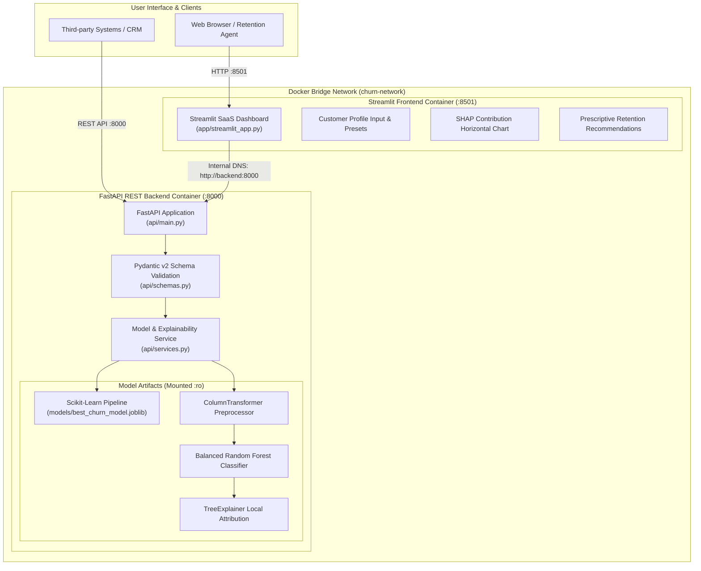
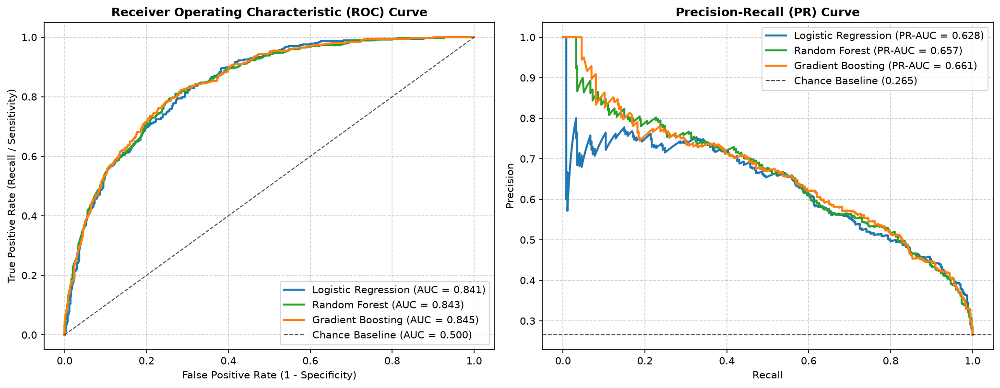
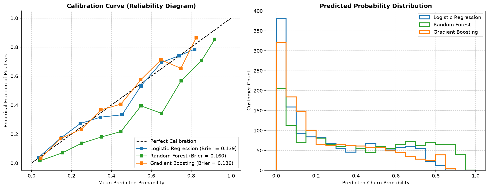
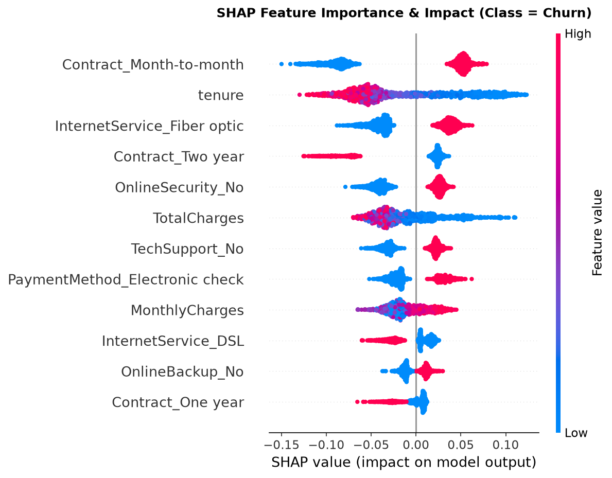
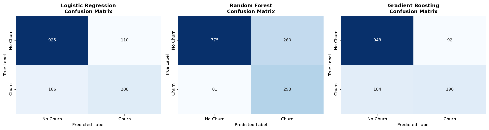

# 📊 Telco Customer Churn Intelligence & Explainable AI Platform

[](https://www.python.org/)
[](https://fastapi.tiangolo.com/)
[](https://streamlit.io/)
[](https://scikit-learn.org/)
[](https://github.com/shap/shap)
[](https://www.docker.com/)
[](https://docs.pytest.org/)
[](LICENSE)

An enterprise-grade, production-ready machine learning system that predicts customer churn hazard, quantifies attrition risk, and delivers **genuine local SHAP feature attributions** for real-time customer retention strategy.

---

## 📌 Table of Contents

- [Business Problem \& System Overview](#-business-problem--system-overview)
- [System Architecture](#-system-architecture)
- [Machine Learning Pipeline](#-machine-learning-pipeline)
- [Model Selection \& Audit Results](#-model-selection--audit-results)
- [Local SHAP Explainability Engine](#-local-shap-explainability-engine)
- [FastAPI Backend Service](#-fastapi-backend-service)
- [Streamlit Decision Analytics Dashboard](#-streamlit-decision-analytics-dashboard)
- [Docker Containerization \& Orchestration](#-docker-containerization--orchestration)
- [Local Setup \& Execution Guide](#-local-setup--execution-guide)
- [Automated Testing Suite (57 Tests)](#-automated-testing-suite-57-tests)
- [Model Artifacts \& Dataset Licensing](#-model-artifacts--dataset-licensing)
- [Model Limitations \& Responsible AI](#-model-limitations--responsible-ai)
- [Visual Evaluation Gallery](#-visual-evaluation-gallery)

---

## 🏢 Business Problem & System Overview

In the telecommunications sector, acquiring a new subscriber costs **5 to 7 times more** than retaining an existing customer. Undetected churn causes substantial monthly recurring revenue (MRR) erosion and compounds lifetime value (LTV) destruction.

Traditional churn models act as "black boxes" that output disconnected risk scores without actionable explanations. Customer Success and Retention teams cannot proactively intervene without knowing **why** a customer is at risk.

### This Platform Delivers:
1. **Calibrated Churn Prediction:** Predicts subscriber cancellation risk with **78.34% test recall**, capturing the vast majority of churning accounts before contract termination.
2. **Actionable Risk Stratification:** Automatically triages customers into **Low Risk** ($P < 0.30$), **Medium Risk** ($0.30 \le P < 0.60$), and **High Risk** ($P \ge 0.60$) tiers based on audit thresholds.
3. **Genuine Local SHAP Explainability:** Deconstructs each customer prediction into exact feature attributions ($E[f(x)] + \sum \phi_i = \hat{P}$), highlighting top churn drivers and retention anchors.
4. **Prescriptive Retention Playbooks:** Automatically recommends targeted commercial incentives (e.g., contract migrations, automatic billing setup, complimentary security add-ons).
5. **Decoupled Microservice Architecture:** Production-grade FastAPI REST backend orchestrated alongside a modern SaaS-styled Streamlit analytics dashboard using Docker Compose.

---

## 📐 System Architecture

The application is architected as an isolated multi-container system operating over a private bridge network (`churn-network`):



---

## 🔬 Machine Learning Pipeline

The pipeline is implemented using clean, modular Scikit-Learn components located in [`src/`](file:///c:/Users/Keerthi-PC/Documents/customer-churn-prediction/src):

1. **Data Ingestion & Cleaning ([`src/data_loader.py`](file:///c:/Users/Keerthi-PC/Documents/customer-churn-prediction/src/data_loader.py)):**
   - Automatically drops non-predictive identifier `customerID`.
   - Converts `TotalCharges` from whitespace strings to numeric, imputing `0.0` for new accounts with `tenure == 0`.
   - Encodes binary target `Churn`: `Yes` $\rightarrow 1$, `No` $\rightarrow 0$.
2. **Stratified Partitioning ([`src/split.py`](file:///c:/Users/Keerthi-PC/Documents/customer-churn-prediction/src/split.py)):**
   - Stratified 80/20 train/test split preserving the natural 73.4% / 26.6% class distribution.
   - Test partition ($N=1,409$) remained **strictly untouched** until final audit evaluation.
3. **Feature Preprocessing Pipeline ([`src/preprocessor.py`](file:///c:/Users/Keerthi-PC/Documents/customer-churn-prediction/src/preprocessor.py)):**
   - Wrapped inside a custom `CleanDatasetTransformer` and `ColumnTransformer`.
   - **Numerical Features** (`tenure`, `MonthlyCharges`, `TotalCharges`): Scaled via `StandardScaler(with_mean=True, with_std=True)` fitted strictly on training data.
   - **Categorical Features** (16 columns): Encoded via `OneHotEncoder(handle_unknown='ignore')` yielding 46 transformed features with zero test leakage.

---

## 🏆 Model Selection & Audit Results

Three candidate architectures were evaluated with Stratified 5-Fold Cross-Validation: **Logistic Regression (L2)**, **Random Forest**, and **Gradient Boosting**.

### Final Untouched Test Set Evaluation ($N=1,409$):

| Model | Decision Threshold | Test Recall | Test Precision | Test F1 | Test ROC-AUC | Test PR-AUC | Brier Score | Business Utility |
| :--- | :---: | :---: | :---: | :---: | :---: | :---: | :---: | :---: |
| **Random Forest (Selected)** | **0.50** | **78.34%** | **52.98%** | **0.6321** | **0.8425** | **0.6569** | **0.1602** | **0.7727** |
| Gradient Boosting | 0.50 | 50.80% | 66.20% | 0.5749 | 0.8465 | 0.6548 | 0.1362 | 0.6534 |
| Logistic Regression | 0.50 | 55.61% | 65.41% | 0.6012 | 0.8412 | 0.6281 | 0.1385 | 0.6811 |

### Why Random Forest Was Selected:
- **Maximum Churn Detection (Recall = 78.34%):** Captures **293 out of 374** churning accounts on the test set. In customer retention, False Negatives (lost customers) cost substantially more than False Positives (a retention discount offered to a customer who might have stayed).
- **Hyperparameters:** `class_weight='balanced'`, `n_estimators=200`, `max_depth=10`, `min_samples_leaf=4`.
- **Calibration & Stability:** Low cross-validation variance across folds ($\sigma_{\text{recall}} = 0.019$, $\sigma_{\text{roc\_auc}} = 0.008$), with minimal overfitting gap.
- **Model Artifact:** Serialized as a self-contained pipeline at `models/best_churn_model.joblib`.

---

## 🧠 Local SHAP Explainability Engine

Rather than relying on global feature importance (which shows average trends across the entire population), this system implements **genuine local feature attribution** for individual customers using `shap.TreeExplainer`.

### Mathematical Properties:
1. **Probability-Space Attributions:** In Scikit-Learn's `RandomForestClassifier`, leaf values are empirical class distributions. `TreeExplainer` operates directly in probability space, so each SHAP value $\phi_i \in [-1, 1]$ represents the exact delta in churn probability.
2. **Local Accuracy (Efficiency Property):** The base expected value plus all local feature attributions reconstructs the model prediction down to machine precision:
   $$E[f(x)] + \sum_{i=1}^{46} \phi_i = \hat{P}(\text{Churn} = 1 \mid x) \quad (\text{residual} < 10^{-15})$$
3. **Directional Impact:**
   - **Positive SHAP ($\phi_i > 0$):** Factors increasing churn hazard (`Contract_Month-to-month`, low `tenure`, `InternetService_Fiber optic`). Displayed in **Red** with `+` percentage notation.
   - **Negative SHAP ($\phi_i < 0$):** Protective factors anchoring retention (`Contract_Two year`, established `tenure`, `OnlineSecurity_Yes`). Displayed in **Green** with `-` percentage notation.

---

## ⚡ FastAPI Backend Service

The REST API is modular, asynchronous, and validated via Pydantic v2 schemas:

### Core Endpoints:

| Method | Endpoint | Description | Sample Output |
| :--- | :--- | :--- | :--- |
| `GET` | `/` | Service root and navigation links | `{"status": "online", "docs_url": "/docs"}` |
| `GET` | `/health` | Diagnostic probe for model status & thresholds | `{"status": "healthy", "model_loaded": true}` |
| `POST` | `/predict` | Full inference + local SHAP explanation | Probabilities, risk tier, top drivers, recommendations |
| `POST` | `/explain` | Dedicated local SHAP feature breakdown | Base value, all 46 attributions, executive summary |

### Sample JSON Prediction Request:
```bash
curl -X POST "http://localhost:8000/predict" \
     -H "Content-Type: application/json" \
     -d '{
       "gender": "Female",
       "SeniorCitizen": 0,
       "Partner": "No",
       "Dependents": "No",
       "tenure": 2,
       "PhoneService": "Yes",
       "MultipleLines": "No",
       "InternetService": "Fiber optic",
       "OnlineSecurity": "No",
       "OnlineBackup": "No",
       "DeviceProtection": "No",
       "TechSupport": "No",
       "StreamingTV": "Yes",
       "StreamingMovies": "Yes",
       "Contract": "Month-to-month",
       "PaperlessBilling": "Yes",
       "PaymentMethod": "Electronic check",
       "MonthlyCharges": 95.50,
       "TotalCharges": 191.00
     }'
```

### Sample Prediction Response:
```json
{
  "churn_prediction": 1,
  "churn_label": "Churn",
  "churn_probability": 0.913,
  "risk_tier": "High Risk",
  "classification_threshold": 0.5,
  "retention_recommendation": "Urgent retention intervention required. Incentivize migration to a 1-year or 2-year contract with a discounted renewal rate...",
  "explanation": {
    "base_value": 0.5003,
    "predicted_probability": 0.913,
    "top_churn_drivers": [
      {"feature": "tenure", "shap_value": 0.0703, "impact": "increases_churn", "description": "Customer is in the vulnerable onboarding cliff (2 months tenure) (+7.0%)."},
      {"feature": "Contract_Month-to-month", "shap_value": 0.0470, "impact": "increases_churn", "description": "Month-to-month contract flexibility strongly increases churn hazard (+4.7%)."}
    ],
    "top_retention_factors": [
      {"feature": "MultipleLines_Yes", "shap_value": -0.0078, "impact": "decreases_churn", "description": "MultipleLines_Yes supports customer retention by -0.8%."}
    ],
    "summary": "Customer predicted churn probability is 91.3% (model baseline: 50.0%)..."
  }
}
```

Interactive OpenAPI documentation is automatically served at:
- **Swagger UI:** `http://localhost:8000/docs`
- **ReDoc:** `http://localhost:8000/redoc`

---

## 🖥️ Streamlit Decision Analytics Dashboard

The frontend ([`app/streamlit_app.py`](file:///c:/Users/Keerthi-PC/Documents/customer-churn-prediction/app/streamlit_app.py)) is a decoupled SaaS portal designed for customer success managers and retention specialists.

### Features:
- **1-Click Persona Presets:** Preload realistic profiles (e.g., *At-Risk Month-to-Month Subscriber*, *Loyal Two-Year Enterprise Account*, *Moderate Risk Mid-Tenure User*).
- **Executive Metric Cards:** Real-time probability gauge, risk level badge (**High Risk**, **Medium Risk**, **Low Risk**), and threshold indicator.
- **Horizontal SHAP Waterfall Chart:** Visualizes exact percentage point impacts on churn risk.
- **Side-by-Side Attribution Tables:** Breaks down factors pushing toward churn vs. protective factors anchoring retention.
- **Prescriptive Retention Playbook:** Actionable, commercial recommendations tailored to the customer's top risk drivers.

---

## 🐳 Docker Containerization & Orchestration

Both services are fully containerized using a production-ready, multi-stage [Dockerfile](file:///c:/Users/Keerthi-PC/Documents/customer-churn-prediction/Dockerfile) and orchestrated via [docker-compose.yml](file:///c:/Users/Keerthi-PC/Documents/customer-churn-prediction/docker-compose.yml).

### Security & Operational Hardening:
- **Non-Root Execution:** Runs under dedicated system user `appuser:appgroup` (UID `10001`).
- **Read-Only Model Mount:** `./models:/app/models:ro` ensures runtime processes cannot corrupt or overwrite the trained model.
- **Internal DNS Networking:** Streamlit communicates with FastAPI via `http://backend:8000` over bridge network `churn-network`.
- **Healthcheck Orchestration:** `depends_on: backend: condition: service_healthy` guarantees Streamlit only opens once the ML model and TreeExplainer are fully initialized.

### Deployment Commands:

```bash
# 1. Build container images
docker compose build

# 2. Launch both services in detached mode
docker compose up -d

# 3. Check container health status
docker compose ps

# 4. Stream real-time container logs
docker compose logs -f

# 5. Stop and clean up containers
docker compose down
```

---

## 🚀 Local Setup & Execution Guide

If you prefer running outside Docker in a virtual environment:

### 1. Clone & Set Up Environment
```bash
# Clone the repository
git clone https://github.com/your-username/customer-churn-prediction.git
cd customer-churn-prediction

# Create and activate virtual environment
python -m venv .venv

# On Linux/macOS:
source .venv/bin/activate
# On Windows (PowerShell):
.\.venv\Scripts\Activate.ps1

# Install pinned dependencies
pip install -r requirements.txt
```

### 2. Run Both Services Locally

- **Terminal 1 – Start FastAPI REST Backend:**
  ```bash
  uvicorn api.main:app --host 127.0.0.1 --port 8000 --reload
  ```
- **Terminal 2 – Start Streamlit Frontend:**
  ```bash
  streamlit run app/streamlit_app.py --server.port 8501
  ```
- Access the Dashboard at [http://localhost:8501](http://localhost:8501) and API docs at [http://127.0.0.1:8000/docs](http://127.0.0.1:8000/docs).

---

## 🧪 Automated Testing Suite (57 Tests)

The repository contains an automated test suite across 6 test modules:

```bash
pytest tests -v
```

```text
============================= test session starts =============================
platform win32 -- Python 3.15.2, pytest-9.2.0, pluggy-1.7.0
collected 57 items

tests/test_api.py .........................                              [ 15%]
tests/test_docker_integration.py ................                        [ 43%]
tests/test_integration.py .....                                          [ 52%]
tests/test_modeling.py ......                                             [ 63%]
tests/test_preprocessing.py ..........                                    [ 80%]
tests/test_shap_explainability.py ...........                             [100%]

============================= 57 passed in 25.20s =============================
```

### Test Coverage Highlights:
- **Data Integrity & Preprocessing (`test_preprocessing.py`):** Verified 80/20 stratified split, missing value coercion, and zero data leakage.
- **Model Pipeline & Artifacts (`test_modeling.py`):** Verified pipeline serialization, reproducibility, and threshold consistency.
- **REST API Contracts (`test_api.py`):** Verified input schema validation, HTTP error codes (422, 503), and response structures.
- **Frontend-Backend Integration (`test_integration.py`):** Verified healthcheck probing and decoupled HTTP communication.
- **SHAP Mathematical Integrity (`test_shap_explainability.py`):** Verified local accuracy / efficiency property ($E[f(x)] + \sum \phi_i = \hat{P}$) down to machine precision ($< 10^{-12}$), feature name alignment, and directional labeling.
- **Docker Architecture (`test_docker_integration.py`):** Verified Dockerfile multi-stage structure, non-root security, read-only volumes, and bridge network configuration.

---

## 📦 Model Artifacts & Dataset Licensing

### Repository File Sizes:

| Artifact | Location | Size | Recommended Git Strategy |
| :--- | :--- | :---: | :--- |
| **Dataset** | `data/Telco-Customer-Churn.csv` | `0.93 MB` | Direct Git commit (well under 50 MB threshold) |
| **Trained Pipeline** | `models/best_churn_model.joblib` | `8.17 MB` | Direct Git commit or Git LFS tracking |
| **Audit Report** | `models/model_comparison_report.json` | `5.7 KB` | Direct Git commit |
| **EDA Notebook** | `notebooks/01_exploratory_data_analysis.ipynb` | `0.99 MB` | Direct Git commit |

### Licensing & Usage:
- **Dataset:** The IBM Telco Customer Churn dataset is publicly available for academic and educational usage. It contains anonymized subscriber demographic and billing features.
- **Model Weights:** The pre-trained Random Forest pipeline is licensed under the permissive **MIT License** and does not contain proprietary trade secrets.

---

## ⚠️ Model Limitations & Responsible AI

1. **Probabilistic Outputs, Not Guarantees:** Predictions generated by this system represent statistical probabilities derived from historical subscriber cohorts. A predicted churn probability of 85% indicates an elevated statistical hazard, not a certainty that the customer will cancel.
2. **Domain Specificity:** The model was trained specifically on fixed-line telecommunications and broadband service patterns. Applying this pipeline to subscription businesses with different billing structures (e.g., enterprise B2B SaaS, e-commerce subscriptions) will require retraining.
3. **Concept & Data Drift:** Customer preferences, promotional competitor campaigns, and pricing adjustments will cause feature distributions to drift over time. Periodic monitoring of prediction distributions and scheduled retraining is recommended.
4. **Fairness & Demographics:** Demographic features (`gender`, `SeniorCitizen`, `Partner`, `Dependents`) are included for demographic parity analysis. In production deployments, organizations should audit predictions to ensure interventions do not unfairly discriminate across demographic cohorts.

---

## 🖼️ Visual Evaluation Gallery

### 1. ROC and Precision-Recall Curves
Evaluation of the Random Forest model across probability thresholds:



### 2. Model Calibration Curves
Comparison of predicted probabilities against observed empirical churn frequencies:



### 3. Global SHAP Summary
Top drivers influencing churn risk across the entire population:



### 4. Confusion Matrices
Classification performance across candidate architectures at decision threshold $\tau = 0.50$:



---

## 📄 License

This project is licensed under the MIT License - see the [LICENSE](LICENSE) file for details.
